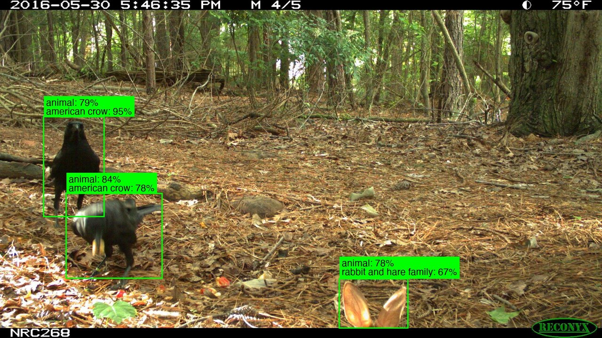

# camtrap-tagger

Tag every animal in a folder of camera-trap images: one species label per animal, boxes drawn on
the images, and empty or uncertain frames sorted out for human review. Built on Google's
[SpeciesNet](https://github.com/google/cameratrapai) (MegaDetector + an EfficientNetV2 species
classifier).



*Each animal gets its own label. The rabbit is only partly visible, so the label falls back to
"rabbit and hare family" rather than guessing a species. Image: ENA24 dataset (see
[credits](#credits)).*

> **Project status:** started in November 2025 as a personal experiment, picked back up and
> cleaned up in October 2026. Per-animal labeling, the original reason for this project, is now
> built into SpeciesNet itself (see [below](#why-this-exists)), so the main value
> here is everything around it: visualization, review folders, a flat results file, and an
> [evaluation](#evaluation) of both approaches on data SpeciesNet likely hasn't seen.

## What it does

1. **Finds** animals, people and vehicles with MegaDetector.
2. **Classifies each animal separately**, so a frame with a deer and a squirrel gets both labels.
3. **Applies SpeciesNet's decision rules per animal**: location-based species filtering
   (geofencing) and taxonomic fallback. A low-confidence species becomes its genus or family
   rather than a wrong guess.
4. **Draws** color-coded boxes with detector and species confidence, placing labels so they
   don't overlap.
5. **Sorts** blank and unknown images into review folders.
6. **Writes one flat results file** with one entry per detection.
7. **Optionally rechecks empty frames** (`--recheck`) with SpeciesNet's whole-image classifier,
   reporting only confident results. In testing this rarely found a missed animal; see
   [evaluation](#evaluation).

## Why this exists

When this project started (November 2025, on SpeciesNet 5.0.3), SpeciesNet gave one label per
image, even when several animals were in the frame. This project worked around that by cropping
every animal and running SpeciesNet's decision logic on each crop separately.

**SpeciesNet now does this itself.** As of version 5.0.6, SpeciesNet classifies every detection
in an image and returns a separate label for each one. camtrap-tagger uses that built-in mode as
its default backend. The original crop method is kept as a second backend so the two can be
compared.

What camtrap-tagger adds on top of SpeciesNet:

- Built-in visualization (SpeciesNet points to separate tools for this)
- Review folders for blank and unknown images
- A flat, per-detection results file instead of nested per-image output
- Input validation (SpeciesNet silently ignores a mistyped country code)
- An optional whole-image recheck of frames where the detector found nothing
- An evaluation harness and results on held-out data (`eval/`)

If you want a desktop app rather than a command-line tool, see
[AddaxAI](https://addaxdatascience.com/addaxai/), which also runs SpeciesNet.

## Install

Requires [uv](https://docs.astral.sh/uv/) (it installs the right Python version for you).

```bash
git clone https://github.com/leeandyg/camtrap-tagger.git
cd camtrap-tagger
uv sync
```

The first run downloads the SpeciesNet model from Kaggle (about 500 MB, cached afterwards;
`--recheck` needs a second model of the same size).
Runs on CPU, Apple Silicon (MPS) or NVIDIA GPUs.

## Usage

```bash
uv run camtrap-tagger path/to/images --country USA --admin1-region CA
```

| Option | Default | Description |
|---|---|---|
| `--out DIR` | `<folder>_tagged` | Output folder |
| `--country CODE` | none | 3-letter ISO country code (e.g. `USA`, `KEN`); enables geofencing |
| `--admin1-region CODE` | none | US state code (e.g. `CA`); requires `--country USA` |
| `--backend {upstream,crop}` | `upstream` | How animals are classified (see below) |
| `--threshold N` | `0.1` | Minimum detector confidence for a detection to count |
| `--model NAME` | SpeciesNet v4.0.3a | Crop classifier model |
| `--recheck` | off | Rerun frames with no detections through the whole-image model |
| `--deployments CSV` | none | Deployment sheet with coordinates and dates (see below) |
| `--file-times` | off | Use file modified times for images without an EXIF capture time |
| `--event-gap MINUTES` | `30` | Images from one deployment this close together form one event |
| `--camtrap-dp` | off | Also write a [Camtrap DP](https://camtrap-dp.tdwg.org) data package (see below) |
| `--timezone TZ` | none | Time zone of the camera clocks, e.g. `America/Los_Angeles` or `-07:00` |
| `--project-title TEXT` | folder name | Camtrap DP project title |
| `--contributor "NAME <EMAIL>"` | none | Camtrap DP contact; repeat for several |
| `--sampling-design` | `opportunistic` | Camtrap DP sampling design (e.g. `targeted`, `systematicRandom`) |
| `--no-viz` | | Don't draw boxes |

Images are found recursively (jpg, png, tif, webp). Output mirrors the input's subfolders:

```
<folder>_tagged/
  results.json                 one entry per detection + summary (counts per category and species)
  results.csv                  the same entries as a spreadsheet, paths relative to the input
  species_counts.csv           animal detections, images and events per species
  deployments.csv              per deployment: coordinates, dates, image and detection counts
  events.csv                   independent events: one row per species per event, with counts
  camtrap-dp/                  Camtrap DP package (with --camtrap-dp)
  speciesnet_predictions.json  raw SpeciesNet output, for debugging
  visualizations/              images with boxes and labels
  review/blank/                images with nothing found
  review/unknown/              images with at least one unidentified detection
  crops/                       per-animal crops (crop backend only)
```

### Capture times and deployments

Each image's capture time is read from its EXIF data. Images without one get an empty
timestamp. `--file-times` falls back to the file's modified time instead, which is only right
if the files were copied off the card with their dates kept; a downloaded file's modified
time is the download time.

A deployment is one camera at one place for one period. By default every folder of images is
a deployment. A deployment sheet adds coordinates and dates:

```csv
deploymentID,folder,latitude,longitude,start,end,locationName
ridge-2024,site1/camA,44.12,-123.45,2024-05-01,2024-08-31,North ridge
creek-2024,site1/camB,44.10,-123.41,2024-05-01,2024-08-31,Creek
```

`folder` is relative to the input folder; images in its subfolders belong to it too.
`deploymentID` and `folder` are required. The sheet is checked before any model runs, and
every problem is listed at once (duplicate IDs, impossible coordinates, unreadable dates,
folders that don't exist, with a suggestion for likely typos). Folders missing from the sheet
get their own deployment, and images taken outside a deployment's dates are flagged
(`outside_deployment` in `results.csv`).

### Events

Camera traps fire in bursts, so one deer can appear in a dozen photos. Ecologists count
independent events (visits) instead: images from one deployment taken less than 30 minutes
apart (`--event-gap`) form one event. Empty frames and images without a capture time are left
out.

Each event lists every species seen in it, so a deer and a turkey in the same visit give two
rows in `events.csv`. The count for a species is the most of it seen in any single photo,
not the sum over the burst. Because SpeciesNet may label the same animal "white-tailed deer"
in one frame and "cervidae family" or "unknown" in the next, a broader label is merged into a
more specific one in the same event when there is only one candidate; with two (say, mule deer
and white-tailed deer), it stays its own row.

### Camtrap DP export

[Camtrap DP](https://camtrap-dp.tdwg.org) is the TDWG standard for camera-trap data. GBIF
accepts it, and R and Python tools such as [camtrapdp](https://inbo.github.io/camtrapdp/),
camtrapR and frictionless read it. `--camtrap-dp` writes a version 1.0.2 package to
`<out>/camtrap-dp/`:

- `deployments.csv`: deployments from the sheet, with coordinates and start/end
- `media.csv`: every image with a capture time; `filePath` is relative to the input folder
- `observations.csv`: one row per detection (`observationLevel` "media", with its bounding box)
  and one row per species per event (`observationLevel` "event", with its count), all marked as
  machine classifications with SpeciesNet's confidence
- `datapackage.json`: project, contributors, and spatial, temporal and taxonomic coverage

```bash
uv run camtrap-tagger photos/ --deployments sheet.csv --camtrap-dp \
    --timezone America/Los_Angeles --project-title "Ridge survey 2024" \
    --contributor "Ann Lee <ann@example.org>" --sampling-design systematicRandom
```

The standard requires coordinates and start/end for every deployment and a time zone for every
timestamp, so `--camtrap-dp` needs a complete deployment sheet and `--timezone`, and checks them
before any model runs. Images without a capture time and folders missing from the sheet are left
out of the package, with a warning. Packages are tested against the official 1.0.2 schemas with
frictionless.

The classifications are the AI's, not human-verified: review them before publishing to GBIF.

### Backends

Both backends use the same detector and the same SpeciesNet decision rules. They differ in how a
detection becomes classifier input:

- **`upstream`**: SpeciesNet's built-in per-detection mode. Classifies every detection above the
  threshold, including people and vehicles, so it can correct a mislabeled box (for example, a
  low-confidence "vehicle" box that is really a person).
- **`crop`**: the original method. Classifies animal detections only, cropping each to 480×480
  with Lanczos resampling, and saves the crops for review.

On held-out data the two are equally accurate and `upstream` is about 1.5× faster (see
[evaluation](#evaluation)), so `upstream` is the default.

### Results format

Each entry in `results.json` is one detection:

```json
{
  "filepath": "/data/site3/IMG_0042.jpg",
  "deployment_id": "site3",
  "timestamp": "2016-05-30T17:46:35",
  "timestamp_source": "exif",
  "outside_deployment": false,
  "event_id": "site3-0012",
  "detection_index": 2,
  "category": "animal",
  "prediction": "rabbit and hare family",
  "prediction_raw": "eastern cottontail",
  "species_conf": 0.67,
  "detector_conf": 0.78,
  "bbox": [0.564, 0.827, 0.112, 0.143],
  "rollup_status": "confidence_rollup",
  "prediction_source": "classifier+rollup_to_family",
  "taxonomy_5part": "mammalia;lagomorpha;leporidae;sylvilagus;floridanus"
}
```

- `category` is `animal`, `human`, `vehicle`, `blank`, `unknown` or `error` (unreadable image).
- `prediction` is the final label; `prediction_raw` is the classifier's top guess before
  geofencing and rollup. The `taxonomy_*` fields describe `prediction_raw`.
- `bbox` is `[x, y, width, height]` as fractions of the image size. It is `null` for animals
  found by the whole-image recheck, which also carry `"note": "detector_missed"`.
- `event_id` links the detection to its row in `events.csv`. In the species counts,
  `detections` counts every photo (a deer in five burst photos counts five times) while
  `events` counts independent visits.

## Evaluation

Both backends were tested on two [LILA](https://lila.science) datasets published in 2026, after
the data snapshot SpeciesNet's paper describes, so they are likely (not certainly) unseen by the
model. Older LILA datasets are probably in SpeciesNet's training data and give inflated numbers:
on ENA24 the same pipeline labels 74% of animals at the exact species.

| | Oregon Critters | AMMonitor Camera Traps |
|---|---|---|
| Sample (multi-animal / single / empty images) | 395 (95 / 200 / 100) | 500 (50 / 250 / 200) |
| Ground truth | a box per animal | labels per image |
| Location given to SpeciesNet | USA, Oregon | USA |

| Metric | Oregon: upstream | Oregon: crop | AMMonitor: upstream | AMMonitor: crop |
|---|---|---|---|---|
| Animals labeled at the exact species | 29.6% | 28.4% | 48.9% | 48.0% |
| Correct at any level (species, genus, family, ...) | 74.0% | 72.8% | 71.4% | 71.7% |
| Wrong label | 4.9% | 6.1% | 10.6% | 11.1% |
| Missed (no detection) | 14.1% | 14.1% | 7.4% | 7.1% |
| Multi-animal images with every animal correct | 41% | 42% | 24% | 32% |
| Empty images correctly left blank | 96% | 96% | 94.5% | 93.5% |
| Seconds per image (Apple Silicon) | 0.29 | 0.44 | 0.26 | 0.39 |

What this shows:

- **The backends are equally accurate**, within a point on both datasets, and `upstream` is about
  1.5× faster, so it is the default.
- **Most correct answers are broader than a species.** In Oregon, the classifier usually thinks
  Roosevelt elk are red deer (a European species); geofencing rules that out for the USA and falls
  back to "cervidae family" instead of a wrong answer. Small birds often come back as just "bird".
- **The whole-image recheck rarely helps.** Unfiltered, it recovered 1 and 2 missed animals but
  marked about 7% of truly empty frames as animals or unknowns. With the confidence filter it now
  uses, it marks no empty frames but recovered 0 and 1 animals, so it is off by default.

Caveats: samples are a few hundred animals each, so differences of a point or two are noise.
Boxes are matched at IoU ≥ 0.5, and about half of Oregon's "missed" animals overlap a predicted
box just below that. AMMonitor is scored per image, not per animal. Images containing people are
withheld from LILA, so human and vehicle accuracy was not measured. SpeciesNet v4.0.3's training
data is not documented, so "unseen" can't be guaranteed.

To reproduce (downloads about 1.5 GB of images into `eval/data/`, which is gitignored):

```bash
uv run python eval/prepare_lila.py --help   # sample a LILA dataset
uv run python eval/run_eval.py eval/data/<dataset> --country USA
```

## Development

```bash
uv run pytest        # ~95 tests, a few seconds, no models needed
```

Code lives in `src/camtrap_tagger/`: `pipeline.py` (orchestration and blank recheck),
`backends.py`, `metadata.py` (capture times and deployments), `events.py`, `camtrapdp.py`,
`results.py`, `visualize.py`, `cli.py`. The evaluation scripts are in `eval/`.

## Credits

- **SpeciesNet** by Google, Apache-2.0. Gadot T, Istrate Ș, Kim H, Morris D, Beery S, Birch T,
  Ahumada J. *To crop or not to crop: Comparing whole-image and cropped classification on a large
  dataset of camera trap images.* IET Computer Vision, 2024.
- **MegaDetector** by Dan Morris and contributors,
  [github.com/agentmorris/MegaDetector](https://github.com/agentmorris/MegaDetector).
- **Sample image** from the [ENA24-detection](https://lila.science/datasets/ena24detection) dataset
  on LILA BC, released under the
  [Community Data License Agreement (permissive variant)](https://cdla.io/permissive-1-0/).
  Yousif H, Kays R, He Z. *Dynamic Programming Selection of Object Proposals for Sequence-Level
  Animal Species Classification in the Wild.* IEEE Transactions on Circuits and Systems for Video
  Technology, 2019.
- **Evaluation data** from LILA BC: [Oregon Critters](https://lila.science/datasets/oregon-critters/)
  (CDLA-Permissive; Appel CL, Lesmeister DB, Kay J, Hallerud M, Tosa MI, Levi T. *Oregon Critters:
  A computer vision model for multispecies wildlife detection from two camera trap modalities.*
  In review) and [AMMonitor Camera Traps](https://lila.science/datasets/ammonitor-camera-traps/)
  (a public-domain composite of ten datasets from the AMMonitor community). Full citations for
  every dataset are in [eval/DATA_CREDITS.md](eval/DATA_CREDITS.md). No evaluation images are
  included in this repository.

## License

MIT. See [LICENSE](LICENSE).

This is an independent project, not affiliated with Google or the SpeciesNet team.
